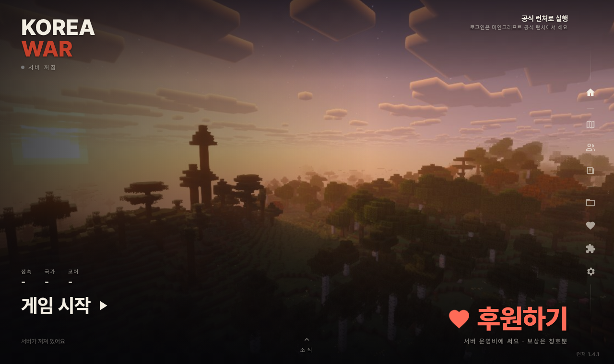

# CGMS Launcher

Launcher for Korea War, a small Minecraft: Java Edition server I run with my friends (a nation-war game on a map of the Korean peninsula).
My friends were having a hard time installing Fabric and keeping our companion mod up to date by hand, so I made this.



What it does:

- signs in with the player's own Microsoft account (Minecraft Java Edition required)
- downloads the game, Fabric and our server's mods, checks them, and keeps them updated
- starts the game and joins the server
- optionally links your Discord account to our server's Discord bot (opens Discord's own approval page in your browser)
- asks for the name you want to be shown as in game (we use real names among friends) and passes it to the server
- shows server status, notices and the war map
- has an optional donation page so friends can chip in for the server bill

It only works with our server. There are no ads. The only personal info it handles is the in-game name you type in, which other players on the server see. There's an optional donation page where friends can chip in a dollar or two for hosting. If the month's hosting cost is covered, everyone on the server gets a little celebration. Sign-in happens on Microsoft's own page in your default browser, so the launcher never sees your password. See [PRIVACY.md](PRIVACY.md).

Until our app ID is approved for Minecraft sign-in, the launcher sets everything up and then opens the official Minecraft Launcher with a "Korea War" installation, and you sign in there.

## Build

Go 1.24 or newer, standard library only.

```
./build.sh 1.4.0
```

## 한국어

Korea War 서버용 런처예요. Fabric이랑 서버 모드를 손으로 깔고 업데이트하는 게 너무 번거로워서 만들었어요.
마이크로소프트 계정으로 로그인하면 게임·Fabric·모드를 받아서 서버로 바로 접속해요. 로그인은 브라우저의 마이크로소프트 페이지에서 해서 비밀번호는 런처가 볼 수 없어요. 광고 없음. 다루는 개인정보는 직접 적는 게임 속 이름(실명)뿐이고, 서버의 다른 친구들에게 그 이름으로 보여요. 서버비를 나눠 내는 후원 화면이 있어요.

Not an official Minecraft product. Not approved by or associated with Mojang or Microsoft.

Uses [qrcode-generator](https://github.com/kazuhikoarase/qrcode-generator) by Kazuhiko Arase (MIT) for the donation QR code.

Questions or problems: open an issue here.

MIT License
