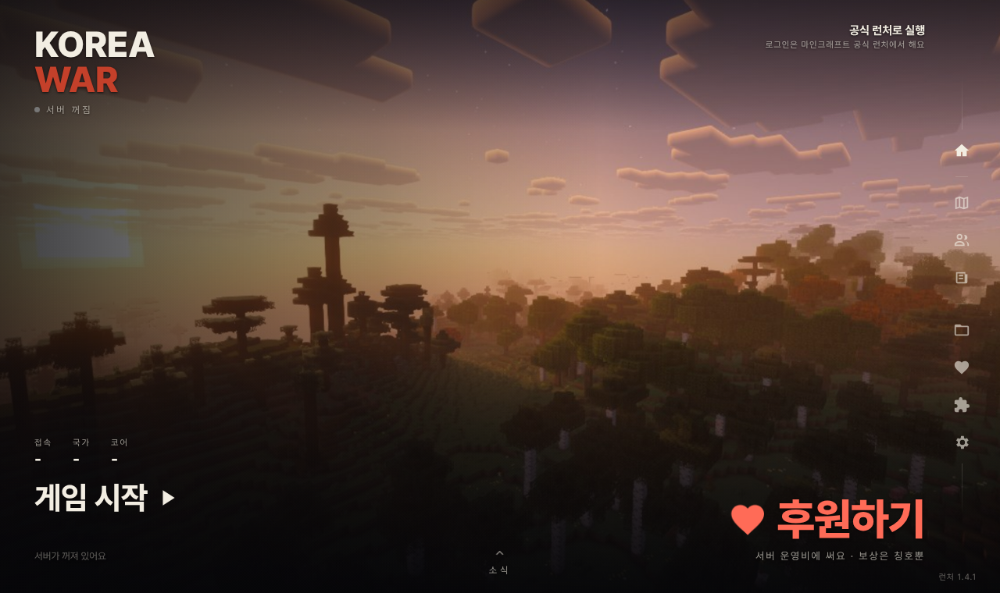

# CGMS Launcher

Launcher for Asia War (formerly Korea War), a small Minecraft: Java Edition server I run with my friends (a nation-war game on a map of the Korean peninsula).
My friends were having a hard time installing Fabric and keeping our companion mod up to date by hand, so I made this.



What it does:

- signs in with the player's own Microsoft account (Minecraft Java Edition required)
- downloads the game, Fabric and our server's mods, checks them, and keeps them updated
- starts the game and joins the server
- optionally links your Discord account to our server's Discord bot (opens Discord's own approval page in your browser)
- asks for the name you want to be shown as in game (we use real names among friends) and passes it to the server
- shows server status, notices and the war map
- has an optional donation page so friends can chip in for the server bill

It only works with our server. There are no ads. The only personal info it handles is the in-game name you type in, which other players on the server see. There's an optional donation page where friends can chip in a dollar or two for hosting. If the month's hosting cost is covered, everyone on the server gets a little celebration. Sign-in happens on Microsoft's own page in your default browser, so the launcher never sees your password. See [PRIVACY.md](PRIVACY.md).

If Microsoft sign-in is not available, the launcher can instead set everything up and open the official Minecraft Launcher with an "Asia War" installation, and you sign in there.

## Download and install

Download the launcher for your system from the [Releases](https://github.com/blham/cgms-launcher/releases) page.
On Windows, run `AsiaWarSetup.exe`. It copies the launcher to `%LOCALAPPDATA%\Programs\AsiaWarLauncher`, adds Start menu and desktop shortcuts and an entry under "Installed apps". It does not need administrator rights and changes no system settings.

Release binaries are built from this repository by GitHub Actions ([build.yml](.github/workflows/build.yml)).

## Uninstall

Windows: Settings → Apps → Installed apps → Asia War Launcher → Uninstall. This removes the launcher, its shortcuts, and its own data folder (game files, mods, settings, logs). Your Minecraft account and the official launcher's files are not touched, except that the "Asia War" installation entry is removed from the official launcher if you used that mode.
macOS / Linux: delete the launcher file and its data folder (`~/Library/Application Support/AsiaWarLauncher` or `~/.local/share/asiawar-launcher`).

## Code signing policy

Free code signing provided by [SignPath.io](https://about.signpath.io/), certificate by [SignPath Foundation](https://signpath.org/).

- Only the Windows binaries of tagged releases are signed, and only when they were built from this repository by the GitHub Actions workflow above. Nothing built on a personal computer is signed.
- Team roles: committer, reviewer and approver — [blham](https://github.com/blham) (the only maintainer; every signing request is approved by hand).
- Changes from other people come in as pull requests and are reviewed before they are merged.

## Privacy policy

This program will not transfer any information to other networked systems unless specifically requested by the user or the person installing or operating it. What it sends, and where, is listed in [PRIVACY.md](PRIVACY.md) and shown in the launcher's terms screen on first run.

## Build

Go 1.24 or newer. Dependencies: [go-webview2](https://github.com/jchv/go-webview2) (MIT) for the Windows window, golang.org/x/sys (BSD-3-Clause).

```
./build.sh 1.9.0
```

## 한국어

Korea War 서버용 런처예요. Fabric이랑 서버 모드를 손으로 깔고 업데이트하는 게 너무 번거로워서 만들었어요.
마이크로소프트 계정으로 로그인하면 게임·Fabric·모드를 받아서 서버로 바로 접속해요. 로그인은 브라우저의 마이크로소프트 페이지에서 해서 비밀번호는 런처가 볼 수 없어요. 광고 없음. 다루는 개인정보는 직접 적는 게임 속 이름(실명)뿐이고, 서버의 다른 친구들에게 그 이름으로 보여요. 서버비를 나눠 내는 후원 화면이 있어요.

Not an official Minecraft product. Not approved by or associated with Mojang or Microsoft.

Uses [qrcode-generator](https://github.com/kazuhikoarase/qrcode-generator) by Kazuhiko Arase (MIT) for the donation QR code.

Questions or problems: open an issue here.

MIT License
